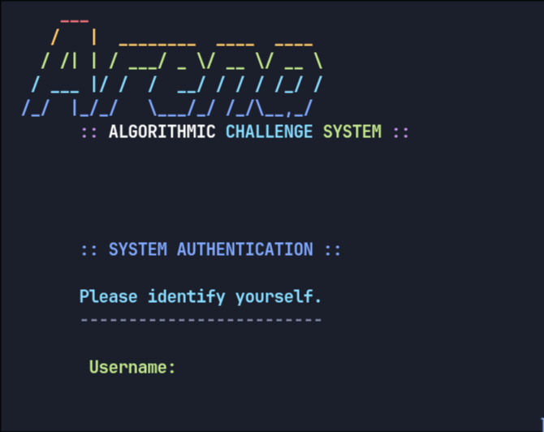
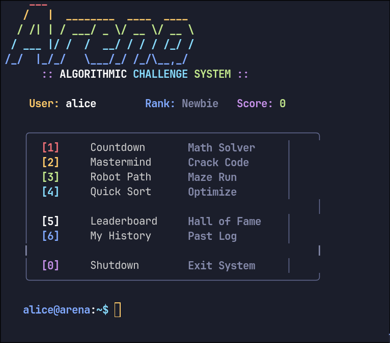
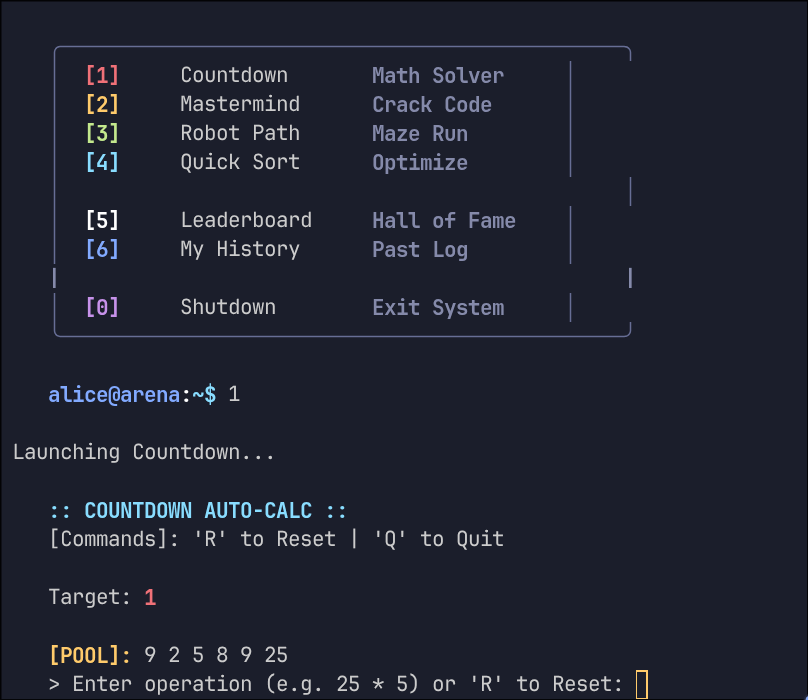
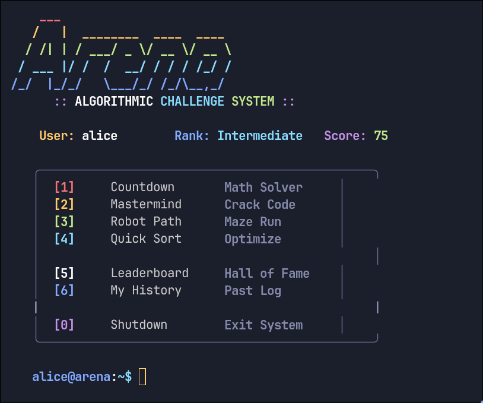

# Arena de Défis

**Arena de Défis** is an interactive terminal program written in C for practicing algorithmic problem solving. Players sign in with a username, choose from four small challenges, earn points, and view their personal history or the global leaderboard.

The interface uses ANSI colors and terminal control sequences. It is intended to run in a Unix-like terminal.

## Screenshots

### Sign-in



### Main menu



### Countdown challenge



### Dashboard after earning points



## Challenges and features

- **Countdown:** Combine a pool of numbers with arithmetic operations to reach a generated target. The game supports resetting a round and exiting back to the menu.
- **Mastermind:** Guess a generated four-digit code. Feedback indicates how many digits are correct and in the right or wrong positions.
- **Robot Path:** Navigate a grid maze using directional commands and try to reach the exit.
- **Ultimate Sort:** Sort a generated array under the challenge's swap constraints.
- **Score and history:** Points are persisted between runs. The application can display a leaderboard and the signed-in player's mission history.
- **Player ranks:** The dashboard labels scores up to 50 as Newbie, 51–100 as Intermediate, and above 100 as Expert.

Points are awarded by each challenge when its completion condition is met. The exact reward can vary by challenge.

## Requirements

- GCC or another C compiler with GNU/POSIX-compatible support
- A Unix-like operating system and terminal
- `make` is optional; the project can be compiled directly with GCC

## Build and run

From the repository root, compile the program:

```sh
gcc -std=c11 -Wall -Wextra -o arena main.c
```

Run it with:

```sh
./arena
```

Enter a username when prompted, then choose a challenge or view the leaderboard and personal history from the main menu. Select `0` to exit.

## Project layout

```text
.
├── main.c                 # Login, dashboard, menu, and program entry point
├── countdown.h            # Countdown arithmetic challenge
├── mastermind.h           # Mastermind code-breaking challenge
├── robot_maze.h            # Robot maze challenge
├── ultimate_sort.h         # Constrained sorting challenge
├── leaderboard.h           # Score persistence, leaderboard, and history
├── assets/                 # README screenshots
└── history_log.txt         # Created/updated as points are earned
```

Challenge implementations currently live in headers and are included by `main.c`; compile `main.c` as the single translation unit shown above. The headers contain function definitions and are not intended to be compiled separately.

## Score storage

When a player earns points, the program appends a semicolon-separated record to `history_log.txt` in the current working directory:

```text
username;challenge;points
```

The same file supplies the total score, leaderboard, and personal history. Keep it in place to retain scores between sessions. The file is generated when the first score is recorded.

## Authors

Created at the École Nationale des Sciences de l’Informatique (ENSI) by:

- Askri Isra
- Elaa Ben Aoun
- Riahi Dalia
